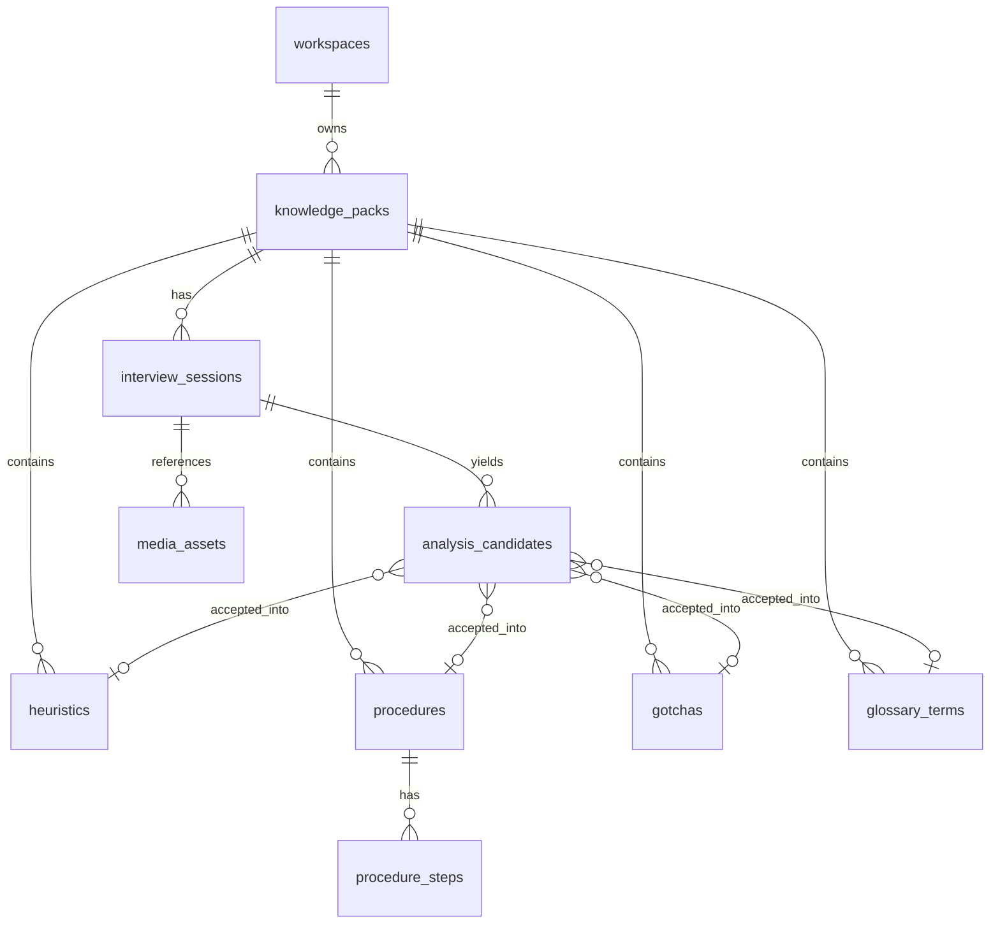

# External data model for KE Studio

**Target:** IBM Db2 LUW **KESTUDIO** on local instance `mdavage` (v12.1.5).  
**Canonical DDL:** [`know-forge/db/kestudio-db2.sql`](kestudio-db2.sql)  
**Apply:** `db2 connect to KESTUDIO; db2 -tvf db/kestudio-db2.sql`

IDs are `CHAR(36)` (client UUIDs). Character arrays/JSON live in `CLOB` columns (`*_json`). Large CLOBs (`transcript`, `payload_json`) use tablespace `ts8k` (8K pagesize). All tables use `COMPRESS YES`. Audio bytes are **not** in the RDBMS — only URIs.

Client types in [`know-forge/src/lib/types.ts`](../src/lib/types.ts) and [`know-forge/src/lib/interview-types.ts`](../src/lib/interview-types.ts) map 1:1 onto these tables.

## Current → external mapping

| Browser today | External store |
|---|---|
| `localStorage` `tribal.knowledge-store.v1` → packs + nested entries + denormalized `pack.interview` | Tables below; `primary_session_id` replaces nested interview blob |
| IndexedDB `tribal.interviews.v1` / `sessions` metadata | `interview_sessions` + `analysis_candidates` |
| IndexedDB `audioBlob` | Object storage / `public/interviews/{id}/`; DB keeps `audio_uri` + mime/duration via `media_assets` |
| `public/interviews/.../transcript.txt`, `analysis.json` | Transcript + candidates in DB (files optional export cache) |
| Theme key `tribal.theme` | Stays local |
| In-progress recorder draft / MediaRecorder buffer | Stays local until upload completes |
| PWA install / `beforeinstallprompt` | Stays local |



## DDL (Db2 LUW — matches kestudio-db2.sql)

```sql
-- Sole source-of-truth: know-forge/db/kestudio-db2.sql
-- Large CLOBs need 8K pagesize (SQL0286N on default 4K USERSPACE1).

CREATE BUFFERPOOL bp8k SIZE 250 PAGESIZE 8K;
CREATE LARGE TABLESPACE ts8k
  PAGESIZE 8K
  MANAGED BY AUTOMATIC STORAGE
  BUFFERPOOL bp8k
  AUTORESIZE YES
  INITIALSIZE 32 M
  MAXSIZE NONE;

CREATE TABLE workspaces (
  id            CHAR(36) NOT NULL,
  name          VARCHAR(256) NOT NULL,
  created_at    TIMESTAMP NOT NULL WITH DEFAULT CURRENT TIMESTAMP,
  updated_at    TIMESTAMP NOT NULL WITH DEFAULT CURRENT TIMESTAMP,
  CONSTRAINT pk_workspaces PRIMARY KEY (id)
) COMPRESS YES;

CREATE TABLE knowledge_packs (
  id                   CHAR(36) NOT NULL,
  workspace_id         CHAR(36) NOT NULL,
  name                 VARCHAR(256) NOT NULL,
  domain               VARCHAR(512) NOT NULL DEFAULT '',
  purpose              VARCHAR(4000) NOT NULL DEFAULT '',
  audience             VARCHAR(1024) NOT NULL DEFAULT '',
  primary_session_id   CHAR(36),
  created_at           TIMESTAMP NOT NULL,
  updated_at           TIMESTAMP NOT NULL,
  CONSTRAINT pk_knowledge_packs PRIMARY KEY (id),
  CONSTRAINT fk_packs_workspace
    FOREIGN KEY (workspace_id) REFERENCES workspaces(id) ON DELETE CASCADE
) COMPRESS YES;

CREATE INDEX idx_packs_workspace ON knowledge_packs(workspace_id);
CREATE INDEX idx_packs_updated ON knowledge_packs(updated_at);

CREATE TABLE heuristics (
  id                 CHAR(36) NOT NULL,
  pack_id            CHAR(36) NOT NULL,
  title              VARCHAR(256) NOT NULL,
  when_clause        VARCHAR(4000) NOT NULL DEFAULT '',
  then_clause        VARCHAR(4000) NOT NULL DEFAULT '',
  because            VARCHAR(4000) NOT NULL DEFAULT '',
  unless_json        CLOB(1M) INLINE LENGTH 1024 NOT NULL DEFAULT '[]',
  confidence         VARCHAR(16) NOT NULL DEFAULT 'medium',
  tags_json          CLOB(256K) INLINE LENGTH 512 NOT NULL DEFAULT '[]',
  source             VARCHAR(512) NOT NULL DEFAULT '',
  source_session_id  CHAR(36),
  created_at         TIMESTAMP NOT NULL,
  updated_at         TIMESTAMP NOT NULL,
  CONSTRAINT pk_heuristics PRIMARY KEY (id),
  CONSTRAINT fk_heuristics_pack
    FOREIGN KEY (pack_id) REFERENCES knowledge_packs(id) ON DELETE CASCADE,
  CONSTRAINT chk_heuristics_confidence
    CHECK (confidence IN ('low', 'medium', 'high'))
) COMPRESS YES;

CREATE INDEX idx_heuristics_pack ON heuristics(pack_id);
CREATE INDEX idx_heuristics_src_sess ON heuristics(source_session_id);

CREATE TABLE procedures (
  id                 CHAR(36) NOT NULL,
  pack_id            CHAR(36) NOT NULL,
  title              VARCHAR(256) NOT NULL,
  goal               VARCHAR(4000) NOT NULL DEFAULT '',
  when_to_use        VARCHAR(4000) NOT NULL DEFAULT '',
  when_not_to_use    VARCHAR(4000) NOT NULL DEFAULT '',
  tags_json          CLOB(256K) INLINE LENGTH 512 NOT NULL DEFAULT '[]',
  source             VARCHAR(512) NOT NULL DEFAULT '',
  source_session_id  CHAR(36),
  created_at         TIMESTAMP NOT NULL,
  updated_at         TIMESTAMP NOT NULL,
  CONSTRAINT pk_procedures PRIMARY KEY (id),
  CONSTRAINT fk_procedures_pack
    FOREIGN KEY (pack_id) REFERENCES knowledge_packs(id) ON DELETE CASCADE
) COMPRESS YES;

CREATE INDEX idx_procedures_pack ON procedures(pack_id);

CREATE TABLE procedure_steps (
  id             CHAR(36) NOT NULL,
  procedure_id   CHAR(36) NOT NULL,
  position       INTEGER NOT NULL,
  action         VARCHAR(4000) NOT NULL DEFAULT '',
  check_text     VARCHAR(4000) NOT NULL DEFAULT '',
  note           VARCHAR(4000) NOT NULL DEFAULT '',
  CONSTRAINT pk_procedure_steps PRIMARY KEY (id),
  CONSTRAINT fk_steps_procedure
    FOREIGN KEY (procedure_id) REFERENCES procedures(id) ON DELETE CASCADE,
  CONSTRAINT chk_steps_position CHECK (position >= 0),
  CONSTRAINT uq_steps_proc_pos UNIQUE (procedure_id, position)
) COMPRESS YES;

CREATE INDEX idx_procedure_steps_proc ON procedure_steps(procedure_id);

CREATE TABLE gotchas (
  id                 CHAR(36) NOT NULL,
  pack_id            CHAR(36) NOT NULL,
  title              VARCHAR(256) NOT NULL,
  symptom            VARCHAR(4000) NOT NULL DEFAULT '',
  cause              VARCHAR(4000) NOT NULL DEFAULT '',
  fix                VARCHAR(4000) NOT NULL DEFAULT '',
  prevention         VARCHAR(4000) NOT NULL DEFAULT '',
  tags_json          CLOB(256K) INLINE LENGTH 512 NOT NULL DEFAULT '[]',
  source             VARCHAR(512) NOT NULL DEFAULT '',
  source_session_id  CHAR(36),
  created_at         TIMESTAMP NOT NULL,
  updated_at         TIMESTAMP NOT NULL,
  CONSTRAINT pk_gotchas PRIMARY KEY (id),
  CONSTRAINT fk_gotchas_pack
    FOREIGN KEY (pack_id) REFERENCES knowledge_packs(id) ON DELETE CASCADE
) COMPRESS YES;

CREATE INDEX idx_gotchas_pack ON gotchas(pack_id);

CREATE TABLE glossary_terms (
  id                 CHAR(36) NOT NULL,
  pack_id            CHAR(36) NOT NULL,
  term               VARCHAR(256) NOT NULL,
  definition         VARCHAR(4000) NOT NULL DEFAULT '',
  aliases_json       CLOB(256K) INLINE LENGTH 512 NOT NULL DEFAULT '[]',
  related_json       CLOB(256K) INLINE LENGTH 512 NOT NULL DEFAULT '[]',
  source             VARCHAR(512) NOT NULL DEFAULT '',
  source_session_id  CHAR(36),
  created_at         TIMESTAMP NOT NULL,
  updated_at         TIMESTAMP NOT NULL,
  CONSTRAINT pk_glossary_terms PRIMARY KEY (id),
  CONSTRAINT fk_terms_pack
    FOREIGN KEY (pack_id) REFERENCES knowledge_packs(id) ON DELETE CASCADE
) COMPRESS YES;

CREATE INDEX idx_terms_pack ON glossary_terms(pack_id);
CREATE UNIQUE INDEX idx_terms_pack_term
  ON glossary_terms(pack_id, term);

CREATE TABLE interview_sessions (
  id              CHAR(36) NOT NULL,
  pack_id         CHAR(36) NOT NULL,
  title           VARCHAR(256) NOT NULL DEFAULT '',
  expert_name     VARCHAR(256) NOT NULL DEFAULT '',
  status          VARCHAR(32) NOT NULL DEFAULT 'ready',
  mime_type       VARCHAR(128) NOT NULL DEFAULT '',
  duration_ms     INTEGER NOT NULL DEFAULT 0,
  has_audio       SMALLINT NOT NULL DEFAULT 0,
  audio_uri       VARCHAR(1024),
  transcript_uri  VARCHAR(1024),
  transcript      CLOB(16M) INLINE LENGTH 4096 NOT NULL DEFAULT '',
  created_at      TIMESTAMP NOT NULL,
  updated_at      TIMESTAMP NOT NULL,
  CONSTRAINT pk_interview_sessions PRIMARY KEY (id),
  CONSTRAINT fk_sessions_pack
    FOREIGN KEY (pack_id) REFERENCES knowledge_packs(id) ON DELETE CASCADE,
  CONSTRAINT chk_sessions_status
    CHECK (status IN ('recording', 'ready', 'analyzed')),
  CONSTRAINT chk_sessions_duration CHECK (duration_ms >= 0),
  CONSTRAINT chk_sessions_has_audio CHECK (has_audio IN (0, 1))
) IN ts8k COMPRESS YES;

CREATE INDEX idx_sessions_pack ON interview_sessions(pack_id);
CREATE INDEX idx_sessions_pack_upd ON interview_sessions(pack_id, updated_at);
CREATE INDEX idx_sessions_status ON interview_sessions(status);

-- NO ACTION (not SET NULL): SET NULL cycles with pack→session CASCADE (SQL20254N).
ALTER TABLE knowledge_packs
  ADD CONSTRAINT fk_packs_primary_session
  FOREIGN KEY (primary_session_id) REFERENCES interview_sessions(id)
  ON DELETE NO ACTION;

ALTER TABLE heuristics
  ADD CONSTRAINT fk_heuristics_source_session
  FOREIGN KEY (source_session_id) REFERENCES interview_sessions(id)
  ON DELETE SET NULL;

ALTER TABLE procedures
  ADD CONSTRAINT fk_procedures_source_session
  FOREIGN KEY (source_session_id) REFERENCES interview_sessions(id)
  ON DELETE SET NULL;

ALTER TABLE gotchas
  ADD CONSTRAINT fk_gotchas_source_session
  FOREIGN KEY (source_session_id) REFERENCES interview_sessions(id)
  ON DELETE SET NULL;

ALTER TABLE glossary_terms
  ADD CONSTRAINT fk_terms_source_session
  FOREIGN KEY (source_session_id) REFERENCES interview_sessions(id)
  ON DELETE SET NULL;

CREATE TABLE media_assets (
  id               CHAR(36) NOT NULL,
  session_id       CHAR(36) NOT NULL,
  kind             VARCHAR(32) NOT NULL,
  uri              VARCHAR(1024) NOT NULL,
  mime_type        VARCHAR(128) NOT NULL DEFAULT '',
  byte_size        BIGINT,
  checksum_sha256  CHAR(64),
  created_at       TIMESTAMP NOT NULL WITH DEFAULT CURRENT TIMESTAMP,
  CONSTRAINT pk_media_assets PRIMARY KEY (id),
  CONSTRAINT fk_media_session
    FOREIGN KEY (session_id) REFERENCES interview_sessions(id) ON DELETE CASCADE,
  CONSTRAINT chk_media_kind
    CHECK (kind IN ('audio_webm', 'audio_wav', 'transcript', 'analysis_export')),
  CONSTRAINT uq_media_session_kind UNIQUE (session_id, kind)
) COMPRESS YES;

CREATE INDEX idx_media_session ON media_assets(session_id);

CREATE TABLE analysis_candidates (
  id                      CHAR(36) NOT NULL,
  session_id              CHAR(36) NOT NULL,
  kind                    VARCHAR(16) NOT NULL,
  title                   VARCHAR(256) NOT NULL,
  excerpt                 VARCHAR(4000) NOT NULL DEFAULT '',
  confidence              VARCHAR(16) NOT NULL DEFAULT 'medium',
  status                  VARCHAR(16) NOT NULL DEFAULT 'pending',
  payload_json            CLOB(4M) INLINE LENGTH 2048 NOT NULL DEFAULT '{}',
  accepted_heuristic_id   CHAR(36),
  accepted_procedure_id   CHAR(36),
  accepted_gotcha_id      CHAR(36),
  accepted_term_id        CHAR(36),
  created_at              TIMESTAMP NOT NULL WITH DEFAULT CURRENT TIMESTAMP,
  updated_at              TIMESTAMP NOT NULL WITH DEFAULT CURRENT TIMESTAMP,
  CONSTRAINT pk_analysis_candidates PRIMARY KEY (id),
  CONSTRAINT fk_candidates_session
    FOREIGN KEY (session_id) REFERENCES interview_sessions(id) ON DELETE CASCADE,
  CONSTRAINT fk_cand_heuristic
    FOREIGN KEY (accepted_heuristic_id) REFERENCES heuristics(id) ON DELETE SET NULL,
  CONSTRAINT fk_cand_procedure
    FOREIGN KEY (accepted_procedure_id) REFERENCES procedures(id) ON DELETE SET NULL,
  CONSTRAINT fk_cand_gotcha
    FOREIGN KEY (accepted_gotcha_id) REFERENCES gotchas(id) ON DELETE SET NULL,
  CONSTRAINT fk_cand_term
    FOREIGN KEY (accepted_term_id) REFERENCES glossary_terms(id) ON DELETE SET NULL,
  CONSTRAINT chk_cand_kind
    CHECK (kind IN ('heuristic', 'procedure', 'gotcha', 'term')),
  CONSTRAINT chk_cand_confidence
    CHECK (confidence IN ('low', 'medium', 'high')),
  CONSTRAINT chk_cand_status
    CHECK (status IN ('pending', 'accepted', 'rejected')),
  CONSTRAINT chk_cand_accepted_kind CHECK (
    status <> 'accepted'
    OR (kind = 'heuristic' AND accepted_heuristic_id IS NOT NULL)
    OR (kind = 'procedure' AND accepted_procedure_id IS NOT NULL)
    OR (kind = 'gotcha' AND accepted_gotcha_id IS NOT NULL)
    OR (kind = 'term' AND accepted_term_id IS NOT NULL)
  )
) IN ts8k COMPRESS YES;

CREATE INDEX idx_candidates_session ON analysis_candidates(session_id);
CREATE INDEX idx_candidates_sess_st ON analysis_candidates(session_id, status);

INSERT INTO workspaces (id, name)
VALUES ('00000000-0000-4000-8000-000000000001', 'KE Studio default');
```

## What stays local vs moves

**Move to Db2**
- Pack meta: name, domain, purpose, audience, timestamps
- All four entry categories (titles + content, tags/aliases as JSON CLOBs, source, confidence)
- Interview session meta, transcript text, analysis candidates + accept/reject status
- Media URIs and checksums

**Stay local (or local-first, then upload)**
- Raw `Blob` / MediaRecorder chunks until upload succeeds
- Offline draft edits (optional IndexedDB outbox), then sync
- UI prefs (`tribal.theme`)
- Temporary Whisper / STT scratch files on device

**Server filesystem (bridge)**
- [`public/interviews/{sessionId}/`](../public/interviews) remains an export/cache; DB transcript + `media_assets.uri` are authoritative after cutover

## Relationship rules

- One pack → many sessions; `knowledge_packs.primary_session_id` replaces denormalized `pack.interview` (`ON DELETE NO ACTION` to avoid SQL20254N cycle with session→pack CASCADE).
- Session → many candidates; accepting a candidate inserts/updates the matching entry table and sets `accepted_*_id`.
- Re-analyze: replace interview-sourced entries via `source_session_id` (or tags containing `interview`).
- Cascade delete pack → entries, sessions, candidates, media rows (object-store GC is a separate job).

## Sync note (for later implementation)

Replace per-page `localStorage` writes in [`storage.ts`](../src/lib/storage.ts) / [`use-knowledge-store`](../src/hooks/use-knowledge-store.tsx) and IndexedDB in [`interview-db.ts`](../src/lib/interview-db.ts) with API calls against this schema; keep a local outbox only for offline record → upload.
